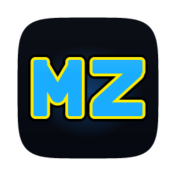
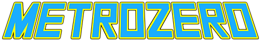

  

  

  Play <b>Metroid: Zero Mission</b> natively on macOS, Windows and Linux.

  
  
  

> [!IMPORTANT]
> MetroZero does not include the game. You need your own legally dumped ROM of
> **Metroid: Zero Mission (USA)**, which MetroZero checks before playing.
> MetroZero is an unofficial fan project. It is not affiliated with, endorsed or sponsored by
> Nintendo. Metroid and all related names are trademarks of their respective owners.

## Download

Get the latest version from the [Releases page](https://github.com/sweatyeggs69/metrozero/releases/latest).

## Features

- **Native on macOS, Windows and Linux**, with smooth, tear-free video and sound.
- **Themed launcher** with **Continue** to pick up where you left off.
- **One settings menu (F1)** for display (scaling, widescreen, screen effects) and controls.
- **Controllers and remapping** for keyboard and gamepads.
- **Save states**: ten slots with thumbnails, quick save/load (Slot 1 by default) and optional auto-load.
- **Widescreen** (16:10 and 16:9) in gameplay, drawn from the room data so the extra columns are real level.
- **Cheats** (F1 > Cheats/Mods): unlimited health, missiles, super missiles and power bombs. Off in RetroAchievements
  hardcore mode.
- **Auto Morph Ball** (F1 > Cheats/Mods > Mods): run into a Morph Ball tunnel and Samus rolls in on her own. Off in
  RetroAchievements hardcore mode.
- **Redux Mode** (F1 > Cheats/Mods): optional quality-of-life tweaks, switched on together or one at a time: faster
  elevators, an accurate clock, bomb jumps in liquids, a Morph Ball that rests when still, and no low health alarm.
  Inspired by [Metroid Zero Mission Redux](https://github.com/ShadowOne333/Metroid-Zero-Mission-Redux) by
  ShadowOne333 and the community hacks it collects; these are MetroZero's own versions for the USA game, applied in
  memory (your ROM file is never changed). Off in RetroAchievements hardcore mode.
- **Import saves** from RetroArch, mGBA, VBA-M and others.
- **RetroAchievements**, optional.
- **Automatic updates** from this repository's releases, with your OK, without touching your saves.
- **Optional BIOS** with the original boot animation (not required).
- **Launcher and menus in six languages**: English, French, German, Spanish, Italian and Brazilian
  Portuguese. MetroZero follows your system language; change it with the language button at the
  bottom of the launcher. The game's own text stays as it is on your cartridge.

## FAQ

**Which version of the game is supported?**
Metroid: Zero Mission, USA release (game code `BMXE`, revision 0).

**Do I need a GBA BIOS?**
No. MetroZero has a built-in replacement. If you own a BIOS dump, Settings > Game > BIOS shows the
original boot animation.

**Where are my saves?**
In your user folder, never inside the app: `~/Library/Application Support/MetroZero/MetroZero/`
(macOS), `%APPDATA%\MetroZero\MetroZero\` (Windows) or `~/.local/share/MetroZero/MetroZero/`
(Linux).

## Contributing

Bug reports and pull requests are welcome. Keep game content out of the repository: no ROMs, BIOS
files, saves, save states, extracted assets or screenshots of the game.

Translations live in `assets/lang/` as gettext `.po` files (Poedit or any text editor works). After
changing text in the code, run `python3 tools/i18n.py update` to refresh them, translate the new
entries, and check with `python3 tools/i18n.py check`. The menu font covers Latin-1, so languages
such as Japanese or Russian also need a font added.

## License

[MIT](LICENSE). Bundled open-source components and fonts are listed in
[THIRD_PARTY_NOTICES.md](THIRD_PARTY_NOTICES.md).
